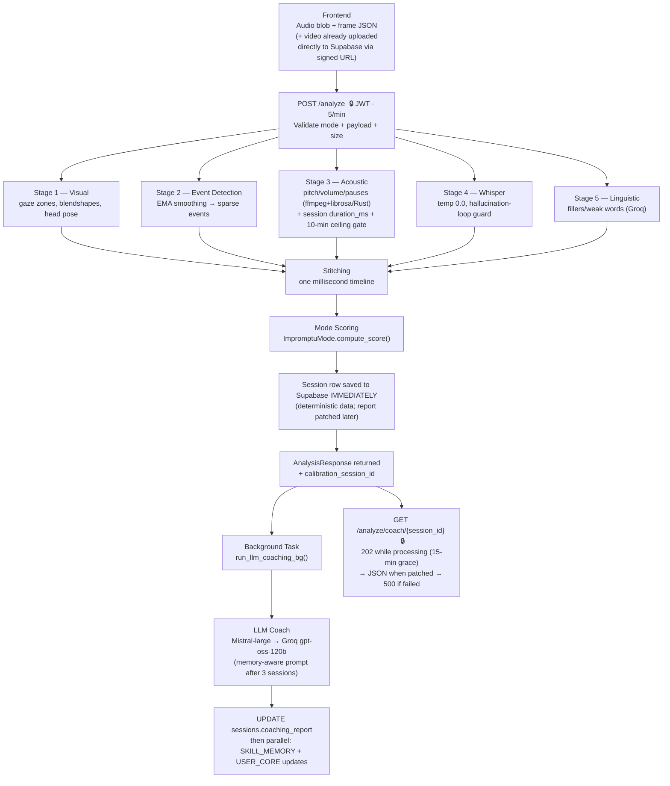

# Vocalyze AI — Architecture

_Accurate as of August 2026 (beta-prep). Historical decision rationale lives in `core/visual/Research.md` and the frontend docs._

## The Core Concept

Every signal collected — visual events, acoustic pauses, transcript words — carries a timestamp.
The engine's job is to **correlate all signals on a single timeline**, score that picture deterministically per coaching mode, then hand it to a strong LLM which produces moment-level coaching feedback — personalised by a persistent per-user memory ("the Soul").

---

## Full Architecture Flow



**Key invariant:** a crash during LLM coaching can never lose the deterministic score/transcript — the row exists before the response is sent.

---

## Pipeline Stages in Detail

### Stage 1 — Visual Analysis
- **Input:** frames from `FrameAnalysisPayload` (may be empty for audio-only fallback)
- **Output:** `GazeBreakdown`, `EmotionSummary`, `HeadPoseSummary`, `ScoreRanges`
- **Files:** `core/visual/gaze.py`, `emotion.py`, `head_pose.py`
- Blendshape naming is observational and honest: `browRaiseScore` (AU1), `cheekSquintScore` (AU6) — no emotion diagnoses.

### Stage 2 — Event Detection
- EMA smoothing (α=0.7) → sustained-run extraction with duration gates
- Events: eye_contact_break (<0.10/400ms), gaze_away (800ms), brow_raise (>0.65/500ms), frown (>0.20/400ms), high_stress (>0.35/500ms), smile (avg>0.30 + Duchenne guard/400ms), eye_closure (>0.50/500ms, center-gated)
- **File:** `core/visual/event_detection.py`

### Stage 3 — Acoustic Analysis
- `WaveformAnalyzer.summarize()` returns pitch variation, RMS volume, pause stats **and `duration_ms`** (decoded length)
- Duration resolution: last frame timestamp when frames exist, else decoded audio (audio-only sessions)
- Server ceiling: >10 min → `413` before Whisper cost is incurred (`max_audio_duration_ms`)
- Pauses ≥1s appended to the event timeline; CPU work in `asyncio.to_thread`

### Stage 4 — Whisper Transcription
- Groq `whisper-large-v3`, `temperature=0.0`, English (`language="en"` — deliberate current focus)
- Trailing-silence trim preserves shared t=0; **hallucination guard** strips ≥6-token pure-filler tail loops
- Key round-robin + fallback rotation

### Stage 4.5 — Stitching
- Words + events merged on one ms axis using session `duration_ms`; `marked_text` with inline markers

### Stage 5 — Linguistic Analysis
- Regex fillers (deterministic) + Groq weak-word extraction; graceful degradation on failure

### Mode Scoring
- `modes/base.py` ABC; `impromptu.py` fully live (weights 35/20/20/25 — see README table); `feynman.py` present; `interview`/`presentation` raise NotImplementedError (frontend gates them "Coming Soon")

### Background Coaching
- `services/llm_coach.py`: memory prefetch (≥3 sessions) → Mistral (45s timeout) → Groq fallback → hardened JSON parse. Fast path for <10-word transcripts (no LLM call).
- `services/coaching_memory.py`: stats increment + two parallel LLM profile updaters (SKILL_MEMORY technical, USER_CORE psychological)

---

## Key Data Contracts

### `RawSignals` additions
`duration_ms` (session-wide, single source of truth for all scoring math), plus per-frame `browRaiseScore`, `cheekSquintScore`, `gazeXBs/gazeYBs` (blendshape gaze prototype, −1…+1).

### `CoachingReport` — LLM output (polled shape)
```json
{
  "analysis_scratchpad": "…",
  "executive_summary": "…",
  "corrections": [{ "category": "…", "before": "…", "after": "…", "why": "…" }],
  "framework_detected": null,
  "strengths": ["…"], "gap_analysis": ["…"],
  "improvement_plan": ["…", "…", "…"],
  "moment_annotations": []
}
```
⚠️ These are the ONLY valid keys. Older field names (`overall_assessment`, `structural_analysis`, `coach_final_note`) no longer exist anywhere.

---

## Frontend ↔ Backend Contract

Video never transits FastAPI:

```
Browser ──POST /uploads/video/upload-url──► FastAPI ──service key──► Supabase sign
Browser ◄──────── { upload_url, path } ─────┘
Browser ──PUT video bytes─────────────────────────────────────────► Supabase (private bucket)
Browser ──POST /analyze (audio only + video_url=path)────────────► FastAPI
Playback ─GET /uploads/video/view-url?path=► short-lived signed GET URL
```

Audio + frames share t=0 from `RecordingScreen`; word timestamps align with frame timestamps by construction.

---

## API Endpoints

| Method | Path | Notes |
|--------|------|-------|
| POST | `/auth/signup` `/auth/login` `/auth/refresh` `/auth/logout` | Rate-limited 5/10/30/min |
| GET | `/auth/me` | id, email, name |
| GET | `/topics/generate?mode=` | Anti-repetition + soul personalisation |
| POST | `/uploads/video/upload-url` | Signed PUT target + storage path |
| GET | `/uploads/video/view-url?path=` | Signed read URL (path regex-validated) |
| POST | `/analyze` | 🔒 5/min. Immediate save → background coach |
| GET | `/analyze/coach/{id}` | 🔒 120/min. 202 grace / 200 / 500 |
| GET | `/sessions`, `/sessions/{id}`, `/profile` | History + Soul |
| GET | `/`, `/cron` | Health / keep-alive |

---

## Async / Concurrency Design

| Task | Strategy |
|------|----------|
| Acoustic analysis + WAV encode | `asyncio.to_thread` |
| Whisper / topic gen / coach / memory | native async HTTP (pooled clients) |
| SKILL_MEMORY + USER_CORE | `asyncio.gather` (parallel) |
| LLM coaching + report patch | FastAPI `BackgroundTasks` |

---

## Production Scaling Considerations

Current capacity: ~2–5 concurrent users before CPU/Groq limits.

1. **CPU-bound acoustic stage** → move pipeline to a worker queue (video already bypasses the API).
2. **Groq RPM** → Redis drip-queue or self-hosted Whisper.
3. **BackgroundTasks are lost on restart** → Celery/RQ for durability. Mitigated today: deterministic results are saved upfront, so only the *report* is at risk; the poll endpoint's 15-min grace converts dead tasks into honest 500s.
4. **Profile increments are read-modify-write** → move to a Postgres function if same-user concurrency ever matters.

---

## Directory Structure

```
backend/
├── main.py                  App factory, CORS, routers, numba warmup
├── config.py                pydantic-settings (incl. max_audio_duration_ms)
├── logging_config.py        File (cleared on restart) + console
│
├── api/
│   ├── limiter.py           Shared slowapi instance
│   ├── deps/auth.py         JWT verification → CurrentUser (id/email/name)
│   └── routes/
│       ├── analysis.py      POST /analyze (save-first) + poll w/ grace window
│       ├── auth.py          GoTrue signup/login/refresh/logout/me (rate-limited)
│       ├── topics.py        Personalised topic generation
│       ├── history.py       /sessions, /profile
│       └── uploads.py       Signed upload/view URLs for private videos
│
├── core/
│   ├── pipeline.py          5-stage orchestrator + duration resolution + ceiling
│   ├── stitching/stitcher.py
│   ├── visual/              gaze.py emotion.py head_pose.py event_detection.py Research.md
│   ├── acoustic/waveform_analyzer.py   Rust fast paths; summarize() → duration_ms
│   ├── linguistic/linguistics.py
│   └── insights/insight_generator.py   Uses signals.duration_ms; gaze-only connection
│
├── modes/                   base.py + impromptu (live) · feynman · interview · presentation
├── models/schemas.py        All contracts (browRaiseScore, cheekSquintScore, gazeXBs/YBs…)
├── services/                llm_coach.py · topic_generator.py · coaching_memory.py
├── clients/groq_client.py   Pooled clients, key rotation, loop guard
├── db/
│   ├── client.py            admin (service_role) + anon (JWT verify) singletons
│   └── repositories/        sessions.py profiles.py (+ ISO timestamps, freq-ranked fillers)
├── tests/unit/              61 passing · smoke_test.py runtime checks
└── vocalyze_core/           Rust PyO3 extension (RMS + pauses)
```
