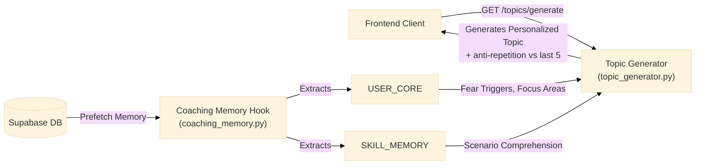
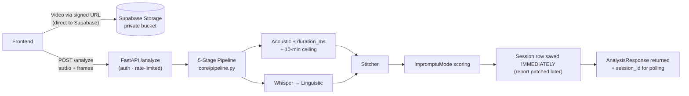
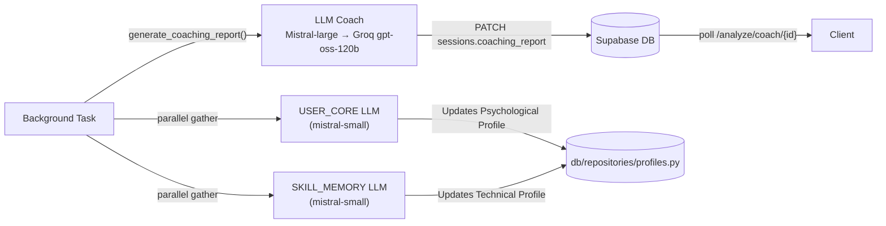

# Vocalyze AI Backend — Comprehensive System Architecture & Data Flow

This document maps out the Vocalyze AI backend architecture: how raw audio is processed, how the AI coach responds, and how the advanced memory profiles (`user_core` and `skill_memory`) act as the "brain" of the system, influencing future sessions.

_Accurate as of August 2026. The earlier "WebSocket Soul Pipeline" design was replaced by the current request/response + background-task flow below._

---

## 1. The 30,000-foot View (Data Flow Graph)

### Phase 1: Preparation (Topic Generation)

### Phase 2: Execution (POST /analyze — no WebSocket)

### Phase 3: Consolidation (Background Memory Update)

---

## 2. The Advanced Memory Architecture (`user_core` & `skill_memory`)

The standard metrics (WPM, filler words) are stateless. To make the AI genuinely intelligent, Vocalyze maintains two deeply structured JSON profiles in the `user_coaching_profiles` table that evolve over time.

### A. The Technical Brain: `skill_memory`

Evaluates the mechanics of speaking across multiple sessions.

- **`pacing_pattern`**: E.g., "Rushes above 180 WPM under pressure."
- **`verbal_tics`**: Aggregates filler words ("um", "like", "basically").
- **`argument_structure`**: E.g., "Tends to ramble without a clear thesis."
- **`linguistic_confidence`**: E.g., "Heavy use of hedging language (maybe, I guess)."
- **`vocabulary_diversity`**: E.g., "Repetitive use of basic adjectives."
- **`grammar_patterns`**: E.g., "Tense mix-ups when nervous."
- **`scenario_comprehension`**: E.g., "Loses focus mid-argument during complex topics."
- **`visual_presence`**: E.g., "Looks away when citing statistics."

### B. The Psychological Brain: `user_core`

Acts as a psychologist profiling the user's mental state and motivations.

- **`fear_profile`**:
  - `primary_fear` (e.g., fear_of_being_wrong)
  - `triggers` (e.g., statistical challenges)
  - `confidence_zones` (e.g., personal storytelling)
  - `avoidance_behaviors` (e.g., accelerating speech rate)
- **`motivation_type`**: E.g., challenge_driven, data_driven.
- **`communication_personality`**: Storyteller, debater, academic.
- **`growth_trajectory`**: Tracks `primary_improvement` and `stagnating_area`.
- **`coaching_stance`**: Instructs the LLM on how to treat the user (e.g., "firm_but_warm", "push_into_discomfort", "priority_focus").

---

## 3. Data Injection: How Memory Influences the Future

The memory isn't just stored; it actively alters the next session. This happens in `services/topic_generator.py`.

When a user requests a new topic, the system loads the `user_core` and `skill_memory`. It extracts specific fields and injects them directly into the LLM prompt:

1. **Anti-Repetition**: Loads the last 5 topics from `topic_history` to ensure the LLM doesn't repeat them. (Static fallback topics are NOT saved to this history.)
2. **Targeting Weaknesses**: Extracts `recurring_weaknesses` and `stagnating_area` (from `user_core`). If the user struggles with "structural clarity", the LLM generates a prompt forcing them to defend a rigid structure.
3. **Trigger Exposure**: Extracts `fear_profile.triggers`. If the user is triggered by "policy debates", the LLM will intentionally generate a policy debate to push them into their discomfort zone.
4. **Leaning on Strengths**: Extracts `confidence_zones`.

**The result**: A topic like *"Argue the economic impact of carbon taxes (Policy Debate) using a rigid three-point structure (Targeting Weakness)."*

---

## 4. The Execution Flow (File-by-File)

### Phase 1: Preparation

1. **`api/routes/topics.py`** -> Authenticated user requests a topic.
2. **`services/topic_generator.py`** -> Fetches last 5 topics + `user_core`/`skill_memory`. Injects triggers, stagnating areas, and confidence zones into the Mistral-small prompt (Groq fallback, static fallback if all fail). Sanity-gated output; LLM topics saved to `topic_history`.

### Phase 2: Session Analysis

1. **Frontend** uploads video directly to Supabase via signed URL from **`api/routes/uploads.py`** — video bytes never reach FastAPI.
2. **`api/routes/analysis.py`** -> Receives audio blob + frame JSON via `POST /analyze`. Validates mode, size (50MB), and later duration (10-min ceiling).
3. **`core/pipeline.py`** -> Orchestrates the 5-stage pipeline; resolves session `duration_ms` (frames or decoded audio).
4. **`core/acoustic/waveform_analyzer.py`** -> Pitch, intensity, pauses (+ Rust fast paths).
5. **`clients/groq_client.py`** -> Whisper-large-v3 at temperature 0.0 with hallucination-loop stripping.
6. **`core/stitching/stitcher.py`** -> Merges words and events onto one timeline.
7. **`modes/impromptu.py`** -> Deterministic score (35/20/20/25) + tips.
8. **Session saved to Supabase immediately** (deterministic data), then response returned.

### Phase 3: Background Consolidation

1. **`api/routes/analysis.py::run_llm_coaching_bg`** ->
   - `services/llm_coach.py` builds a memory-aware prompt (`prefetch_memory`) and calls Mistral → Groq.
   - Report patched into the existing session row (`update_coaching_report`); frontend polls `/analyze/coach/{id}` — 202 within a 15-minute grace window, then honest 500.
   - `services/coaching_memory.py::on_session_end` updates stats, then fires SKILL_MEMORY + USER_CORE LLM calls in parallel. Presence signals use honest metrics: `gaze_center_pct` (not the MediaPipe-capped eye-contact) and observable brow/lip tension (`avg_brow_raise`, mouth press).

---

## 5. Backend Directory Guide

> [!TIP]
> **Core Pipeline Logic** lives in `backend/core/`
> **LLM Intelligence** lives in `backend/services/`
> **Network/Endpoints** live in `backend/api/`

- **`main.py`**: FastAPI entry point, router registration, numba warmup.
- **`api/routes/analysis.py`**: /analyze (save-first flow) + coach polling with grace semantics.
- **`api/routes/uploads.py`**: Signed upload/view URLs for the private video bucket.
- **`services/coaching_memory.py`**: The background brain — `prefetch_memory`, `on_session_end`, USER_CORE/SKILL_MEMORY prompts.
- **`services/llm_coach.py`**: Memory-aware coaching report generator (Mistral→Groq, <10-word fast path).
- **`services/topic_generator.py`**: Personalisation engine injecting memory into topics.
- **`core/pipeline.py`**: Master orchestrator.
- **`db/repositories/profiles.py`**: Soul store CRUD (ISO timestamps, frequency-ranked fillers).
